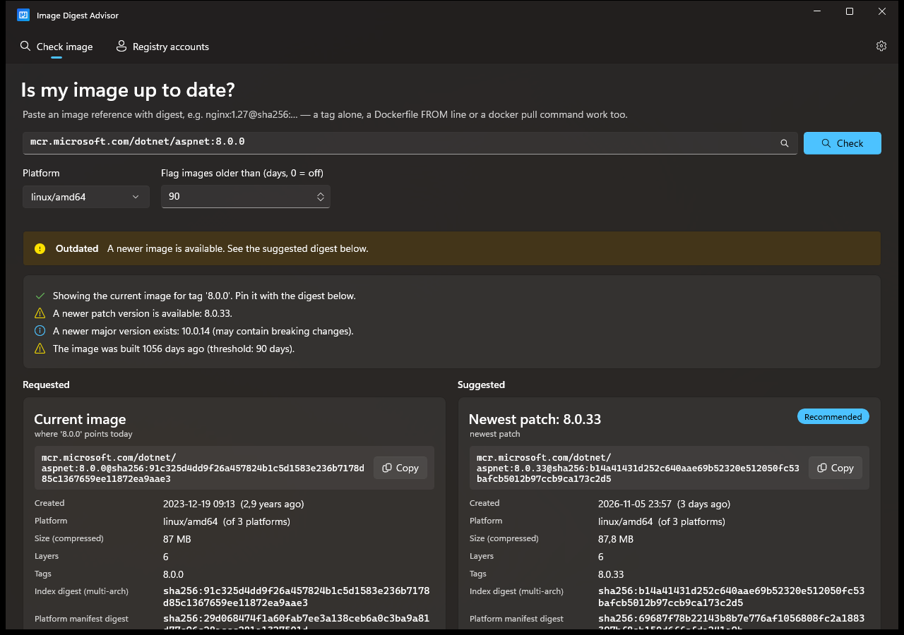

# Image Digest Advisor

**Is my pinned container image still up to date?** Image Digest Advisor is a Windows app that checks a Docker image digest such as `nginx:1.26@sha256:192e…` and tells you whether it is outdated. If it is, the app suggests an updated `repo:tag@sha256:…` reference that you can paste into your Dockerfile, compose file or Kubernetes manifest.



- [For users](#for-users): [supported registries](#supported-registries), install, check an image, read the result, registry accounts
- [For developers](#for-developers): architecture, build, releases
- [License](#license): free software under GPL-3.0

---

# For users

## What the app tells you

For an image you enter, the app checks:

| Check | Example |
|---|---|
| **Has the tag moved?** The same tag now points to a newer build. | `nginx:1.26` was rebuilt, and your digest is the old build. |
| **Is there a newer patch or minor version?** It stays in the same variant. | `1.26.0` → `1.26.3`, or `1.27.2-alpine` → `1.31.8-alpine` (never `-bookworm`) |
| **Is there a new major version?** Shown for information only. | `8.0.x` → `10.0.x` |
| **Is the image old?** It was built more than *n* days ago (default 90). | "built 919 days ago" |

For your image and for each suggestion it shows the build date and age, platform, size, number of layers, all tags pointing to it, the digests, and the image's labels (version, source repository, revision).

## Supported registries

The app talks directly to registries over the standard **OCI Distribution API**, the same protocol `docker pull` uses. Any registry that implements it works.

| Registry | Host | Public images without login | Login for private images / higher limits | Notes |
|---|---|---|---|---|
| **Docker Hub** | `docker.io` (or no host: `nginx`, `bitnami/redis`) | ✅ | Docker ID + personal access token | Fastest tag lookup via the Docker Hub API. Anonymous use is rate-limited; the app shows the remaining pulls. ✔ tested |
| **Microsoft Container Registry** | `mcr.microsoft.com` | ✅ | not needed (public only) | e.g. `mcr.microsoft.com/dotnet/aspnet:8.0`. ✔ tested |
| **GitHub Container Registry** | `ghcr.io` | ✅ | GitHub username + PAT with `read:packages` | ✔ tested |
| **Quay** | `quay.io` | ✅ | Robot account + token | ✔ tested |
| **Azure Container Registry** | `<name>.azurecr.io` | only if anonymous pull is enabled | Repository-scoped token, admin user, or an existing `docker login` / `az acr login` | |
| **Amazon ECR Public** | `public.ecr.aws` | ✅ | not needed | |
| **Amazon ECR (private)** | `<account>.dkr.ecr.<region>.amazonaws.com` | – | `docker login` with the ECR credential helper (`docker-credential-ecr-login`) | ECR passwords expire after 12 hours, so the credential helper is the practical option |
| **Google Artifact Registry** | `<region>-docker.pkg.dev` | for public repositories | `docker login` via `gcloud auth configure-docker`, or user `oauth2accesstoken` + access token | |
| **GitLab Container Registry** | `registry.gitlab.com` (or self-hosted) | for public projects | Username + personal/deploy token with `read_registry` | |
| **Self-hosted** | Harbor, Sonatype Nexus, JFrog Artifactory, Gitea/Forgejo, `registry:2`, … | depends on setup | Username + password/token | Must be reachable over **HTTPS** |

✔ tested = verified against the live registry. The other registries use the same standard protocol and authentication (Bearer token or Basic auth), so they're expected to work. If one doesn't, please [open an issue](https://github.com/hvetter-de/Image-Digest-Advisor/issues).

**Logins** can come from the app's **Registry accounts** page, or from an existing `docker login` on your PC, including credential helpers like Docker Desktop, ECR or gcloud, if they're installed. See [Registry accounts](#registry-accounts-optional).

**Not supported:**
- Registries over plain **HTTP** (e.g. an insecure `localhost:5000`). Self-signed HTTPS certificates must be trusted by Windows.
- Images in the old **Docker schema 1** manifest format (pre-2017).
- Docker Hub mirrors or pull-through caches don't have their own tag API. They work like any other registry, but finding the tag of a bare digest is slower.

**Image types:** Linux and Windows images, single-platform and multi-arch images (choose the platform in the app), Docker and OCI manifest formats.

## Install

**Requirements:** Windows 10 version 1809 or later, or Windows 11, on x64 or ARM64. You **don't need Docker**, and you don't need to install a separate runtime.

1. Open the [latest release](https://github.com/hvetter-de/Image-Digest-Advisor/releases/latest) and download the setup for your PC:
   - **`ImageDigestAdvisor-win-x64-Setup.exe`** for most Windows PCs (Intel/AMD)
   - **`ImageDigestAdvisor-win-arm64-Setup.exe`** for ARM devices (e.g. Snapdragon laptops)
2. Run the setup. It installs for your user only, so **no admin rights** are needed, and it adds a Start menu and desktop shortcut.

If Windows shows *"Windows protected your PC"*, click **More info › Run anyway**. This appears because the app isn't code-signed yet.

**Uninstall** via *Windows Settings › Apps › Installed apps › Image Digest Advisor*.

**Without installing:** download the `Portable.zip` for your PC instead, unzip it anywhere and start `ImageDigestAdvisor.exe`.

A Microsoft Store version is planned.

### Updates

The app keeps itself up to date:

- When it starts, it checks GitHub for a new release and **downloads it in the background**.
- A green bar then says **Update ready**. Click **Restart and update**, or simply keep working: the update is installed the next time you start the app.
- Updates are small, because usually only the changed parts are downloaded.
- You can check manually or turn off the automatic check under **Settings › Updates**.

## Check an image

1. Paste the image into the input box and click **Check** (or press Enter).
2. If you deploy on something other than a normal Intel/AMD server, choose the **Platform** (e.g. `linux/arm64`).
3. Optionally, change **Flag images older than** (days). Use `0` to turn the age check off.

These inputs all work:

| You enter | What the app does |
|---|---|
| `nginx:1.26@sha256:192e…` | **Best.** Compares your digest with the tag and newer versions. |
| `nginx@sha256:192e…` | Finds the tag of the digest itself, then compares. |
| `nginx:1.26` | Shows the current digest of the tag, so you can pin it, plus newer versions. |
| `FROM nginx:1.26 AS build` | A Dockerfile line works too. |
| `docker pull ghcr.io/owner/app:v1.2.3` | So does a pull command. |

Images from Docker Hub can be written without the registry (`nginx`, `bitnami/redis`). For other registries, include the host: `mcr.microsoft.com/dotnet/aspnet:8.0`.

Recent inputs are remembered. Click into the empty input box to see them.

## Read the result

**The status bar** at the top gives the verdict:

- 🟢 **Up to date**: no newer image was found for this tag.
- 🟡 **Outdated**: the tag has moved, a newer patch or minor version exists, or the image is older than your limit.
- 🔵 **Could not determine**: the tag of the digest is unknown. Enter the image as `repo:tag@sha256:…`.

**The findings list** explains each reason, e.g. *"Tag '1.26' now points to a different image, built 278 days later than yours."*

**Requested vs. Suggested:** on the left is your image, on the right are the suggested updates. Each card has a **Copy** button for the ready-to-paste reference. One suggestion is marked **Recommended**:

1. the newest **patch** of your version line, otherwise
2. the **current digest of your tag** (same tag, rebuilt), otherwise
3. the newest **minor** version.

A new **major** version is shown but never recommended automatically, because it may contain breaking changes.

> **Tip:** Copy the reference **with** the tag, e.g. `nginx:1.26.3@sha256:41b1…`. The digest guarantees the exact image, and the tag keeps it readable.

The suggested digest is the **multi-arch digest** when the image supports several platforms. It works on every platform the image supports.

## Registry accounts (optional)

Public images need **no login**. Add an account under **Registry accounts › Add account** if:

- you check **private images**, e.g. in Azure Container Registry or a private GitHub repository, or
- you hit **Docker Hub's rate limit**. Without login, Docker Hub allows only a small number of image pulls per hour per IP address. After each Docker Hub check, the app shows how many are left.

Use an **access token** rather than your password:

| Registry | Username | Token |
|---|---|---|
| Docker Hub (`docker.io`) | Your Docker ID | Personal access token with *Public repo read-only* access, created at app.docker.com › Account settings › Personal access tokens. A free account is enough. |
| GitHub (`ghcr.io`) | Your GitHub username | Personal access token (classic) with the `read:packages` scope |
| Azure (`*.azurecr.io`) | Token name or admin user | Repository-scoped token password (Azure portal › Registry › Tokens) |
| Quay (`quay.io`) | Robot account name | Robot token |

Click **Test connection** before saving.

- **Where tokens are stored:** in **Windows Credential Manager**, never in plain files.
- **Existing `docker login`:** if you have used `docker login` on this PC, those logins are picked up automatically and shown as read-only.
- **A login that no longer works:** if a saved login is rejected, public images still work without it.

## Settings, data and privacy

- **Cache:** image information is stored by digest in `%LOCALAPPDATA%\ImageDigestAdvisor.Data\cache`. That content can never change, so checking the same image again is fast and doesn't use up Docker Hub's limit. You can clear it under **Settings › Clear cache**.
- **Preferences** (platform, age limit, recent inputs, automatic update check) are stored in `%LOCALAPPDATA%\ImageDigestAdvisor.Data\settings.json`. They survive updates. Delete the folder to remove them after uninstalling.
- **Network:** the app only connects to the registries you check, `hub.docker.com` for Docker Hub tag lists, and `github.com` to look for updates. Credentials are only sent to the registry they belong to. **No telemetry** is collected.

## Troubleshooting

| Problem | What to do |
|---|---|
| *"Docker Hub rate limit reached"* | Add a free Docker Hub account (see above), or wait about an hour. |
| *"Access … was denied"* | The repository is private or the name is misspelled. Check the name, or add an account for that registry. |
| *"… was not found"* | The tag or digest doesn't exist in this repository. Is the registry host part of the name? |
| *"Could not determine"*, or no suggestions | Enter the tag as well: `repo:tag@sha256:…`. |
| *"The tag … was guessed"* | The digest no longer has a tag, so the app used the version stored inside the image. Add the tag to your input for exact results. |
| *"not available for linux/arm64"* | The suggested image doesn't support your platform. Choose another version. |
| *"Update check failed"* | Usually no internet connection, or GitHub is blocked by a proxy. The app keeps working; try again later under **Settings › Updates**. |
| The app doesn't start | Send `%LOCALAPPDATA%\ImageDigestAdvisor.Data\crash.log` to the maintainer, or [open an issue](https://github.com/hvetter-de/Image-Digest-Advisor/issues). |

---

# For developers

Windows desktop app built with **WinUI 3 / Windows App SDK** on **.NET 10**, MVVM with CommunityToolkit.Mvvm, and tests with **MSTest**.

## Solution layout

| Project | Purpose |
|---|---|
| `src/ImageDigestAdvisor.Core` | All logic: reference parsing, OCI registry client (token auth, caching), Docker Hub tag API, credential chain, analyzer. No UI dependency. |
| `src/ImageDigestAdvisor.App` | WinUI 3 app (MVVM with CommunityToolkit.Mvvm). Single-project MSIX, also builds unpackaged. Velopack for installer and updates. |
| `tests/ImageDigestAdvisor.Core.Tests` | MSTest tests against an in-memory fake registry. They make no network calls. |
| `build/pack.ps1` | Publishes the app and creates the Velopack packages (Setup.exe, portable zip, update packages). |
| `.github/workflows` | `ci.yml` builds and tests every push and PR. `release.yml` publishes releases from version tags. |

Entry points: `DigestAnalyzer` (the analysis), `RegistryClient` (OCI Distribution API), `ImageDigestAdvisorServices` (composition root), `AnalyzePage` (main UI), `Program` and `UpdateService` (Velopack startup and updates).

## How an analysis works

1. Parse the reference (`nginx` → `docker.io/library/nginx`).
2. Load the manifest by digest. For a multi-arch index, pick the platform manifest. Then read the config blob to get the created date, labels and environment.
3. List tags. Docker Hub uses its web API, which includes digests. Other registries use `/v2/<repo>/tags/list`.
4. Find the tags of the digest. If there are none, use version hints from the image (`org.opencontainers.image.version`, `*_VERSION` environment variables) and confirm them with HEAD requests.
5. Resolve the same tag's current digest, plus the newest patch, minor and major in the same tag family. A family means the same prefix, the same number of version parts, and the same suffix with digits ignored (see `TagVersion`).
6. Build findings and an overall status, and deduplicate suggestions by digest.

## How credentials are resolved

1. Accounts saved in the app (Windows Credential Manager, `ImageDigestAdvisor:<registry>`).
2. `%USERPROFILE%\.docker\config.json` (or `%DOCKER_CONFIG%`). This includes credential helpers such as `docker-credential-desktop`, but only if they are installed. A missing file or helper is skipped.
3. Anonymous.

If saved credentials are rejected, the app falls back to anonymous access so public images keep working. ACR identity tokens (`<token>` username) use the OAuth2 refresh-token flow.

## Rate limits

Docker Hub limits anonymous pulls per IP. The app keeps usage low:

- Tags are resolved with HEAD requests, which don't count against the limit.
- Tag→digest lists come from the Docker Hub web API.
- Manifests and configs are cached on disk by digest, forever (content-addressed), under `%LOCALAPPDATA%\ImageDigestAdvisor.Data\cache`. Content is verified against its digest on read.
- The remaining limit (`ratelimit-remaining` header) is shown after each Docker Hub check.

## Build and run

Requires the .NET 10 SDK. Visual Studio 2026 with the *WinUI application development* workload is recommended for debugging.

```powershell
dotnet test --project tests\ImageDigestAdvisor.Core.Tests
dotnet build src\ImageDigestAdvisor.App -p:Platform=x64 -p:Unpackaged=true
.\src\ImageDigestAdvisor.App\bin\unpackaged\x64\Debug\net10.0-windows10.0.19041.0\win-x64\ImageDigestAdvisor.exe
```

Unpackaged builds go to `bin\unpackaged\` and `obj\unpackaged\`, separate from packaged (MSIX) builds. The two modes produce different `resources.pri` files, so they must not share an output folder.

In Visual Studio, choose the launch profile **ImageDigestAdvisor (Package)** (MSIX) or **(Unpackaged)**. The unpackaged profile needs the build property `Unpackaged=true`.

## Releases and automatic updates

Releases are built by GitHub Actions ([`release.yml`](.github/workflows/release.yml)) with [Velopack](https://velopack.io). To publish a version, push a tag:

```powershell
git tag v1.2.0
git push origin v1.2.0
```

The workflow then:
1. runs the tests,
2. builds self-contained x64 and ARM64 apps with the version from the tag,
3. packs them with Velopack, creating delta updates against the previous release,
4. publishes the GitHub release.

Release assets per architecture:

| File | Purpose |
|---|---|
| `ImageDigestAdvisor-win-<arch>-Setup.exe` | Installer for users (per user, no admin rights) |
| `ImageDigestAdvisor-win-<arch>-Portable.zip` | Portable version, which can also update itself |
| `*-full.nupkg`, `*-delta.nupkg` (from the second release on), `releases.win-<arch>.json` | Used by the updater. Don't delete them from a release. |

- **Pre-releases:** tags with a suffix (`v1.3.0-beta.1`) become GitHub pre-releases, and installed apps don't update to them.
- **Test build:** *Actions › Release › Run workflow* builds the packages as a workflow artifact without publishing anything.

**How the app updates:** `Program.Main` calls `VelopackApp.Build().Run()` before WinUI starts. That's why `DISABLE_XAML_GENERATED_MAIN` is defined. `UpdateService` checks GitHub Releases via `GithubSource`, downloads in the background and offers *Restart and update*. A downloaded update is otherwise applied on the next start. Only installed apps (Setup.exe or the Velopack portable zip) update; dev and MSIX builds don't.

**Velopack and app data:** Setup.exe installs to `%LOCALAPPDATA%\ImageDigestAdvisor` and replaces it on updates. User data therefore lives in `%LOCALAPPDATA%\ImageDigestAdvisor.Data` (`AppPaths`).

**Build packages locally:**

```powershell
dotnet tool restore                      # installs vpk (pinned in dotnet-tools.json)
./build/pack.ps1 -Version 0.9.0 -Runtime win-x64 -OutputDir artifacts/releases
```

**Test the update flow locally:**

1. Pack two versions into the same output folder.
2. Install the older one with its `Setup.exe` (keep a copy before packing the newer one).
3. Start the installed app with `IMAGEDIGESTADVISOR_UPDATE_SOURCE=<full path to artifacts\releases>`. The app then reads updates from that folder instead of GitHub.

Uninstall the test with `%LOCALAPPDATA%\ImageDigestAdvisor\Update.exe uninstall --silent`.

**Microsoft Store (MSIX):**

1. Reserve the app name in Partner Center.
2. In Visual Studio: *Project › Publish › Associate App with the Store*. This updates `Package.appxmanifest` Identity/Publisher.
3. *Publish › Create App Packages* (Store), then upload the `.msixupload`.
4. The listing needs a privacy policy URL. The app's behaviour is described under *Settings › About*: it only contacts the checked registries and hub.docker.com, stores credentials locally, and collects no telemetry.

A local test package can be built with:

```powershell
dotnet publish src\ImageDigestAdvisor.App -c Release -p:Platform=x64 -p:GenerateAppxPackageOnBuild=true -p:AppxPackageDir=bin\msix\ -p:UapAppxPackageBuildMode=SideloadOnly -p:AppxBundle=Never
```

The package is unsigned. To sideload it, sign it with a certificate trusted on the target machine.

## Known limitations

- Docker Hub's web API returns only the 1,000 most recently updated tags anonymously. For older digests, the tag is found through the version the image reports about itself, such as `NGINX_VERSION` or the `org.opencontainers.image.version` label.
- On registries without a digest-aware tag API, a bare digest (no tag) is matched by probing up to 150 tags with HEAD requests. Entering `repo:tag@digest` is always exact.
- Unhandled exceptions are written to `%LOCALAPPDATA%\ImageDigestAdvisor.Data\crash.log`.
- Installers and executables are not code-signed yet, so Windows SmartScreen warns on first start. Velopack can sign during packing (`--signParams` or `--azureTrustedSignFile`) once a certificate is available.

---

# License

Image Digest Advisor is free software: you can redistribute it and/or modify it under the terms of the **GNU General Public License v3.0 or later** (GPL-3.0-or-later). See [LICENSE](LICENSE).

In short:
- **Allowed:** anyone may use, study, change and share the app and its code.
- **Required:** every distributed copy or modified version must also be released under the GPL with its complete source code, so it can never become closed source.
- **No warranty:** the software comes without any warranty.

Contributions are welcome via issues and pull requests. By contributing, you agree that your contribution is licensed under the same license.

Third-party components keep their own licenses: Windows App SDK, CommunityToolkit.Mvvm and Velopack (all MIT). All are compatible with the GPL.
